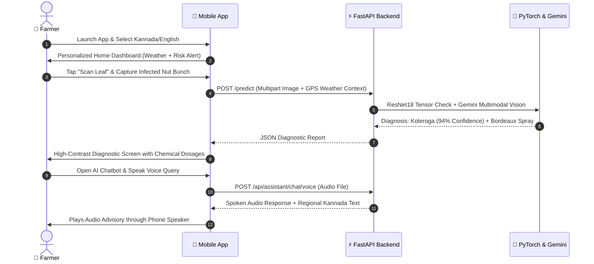

# 🌿 ArecaCare AI — Mobile Application

> **Production-Ready React Native (Expo) Mobile Application for Arecanut Farmers.**  
> *Instant Disease Diagnosis • Weather-Driven Warning Radar • Regional Voice AI Agronomist • Precision Yield Intelligence*

[](https://reactnative.dev/)
[](https://expo.dev/)
[](https://developer.mozilla.org/)
[]()
[]()

---

## 📱 1. Application Overview

**ArecaCare AI Mobile** is a full-featured agricultural mobile assistant purpose-built for arecanut plantation growers. Combining an intuitive, high-contrast UI tailored for field visibility with cutting-edge AI, the app translates complex plant pathology and meteorological forecasting into clear, actionable farming directives in local languages.

### 🌟 Core Capabilities
1. **Camera AI Disease Scanner:** Point your smartphone camera at an infected arecanut leaf or nut bunch for instant computer vision disease diagnosis (Koleroga, Yellow Leaf Disease, Bud Rot, Anabe Roga, or Healthy) with confidence percentages and certified organic/chemical remedies.
2. **Out-of-Distribution (OOD) Rejection:** Protects diagnosis accuracy by rejecting non-arecanut or corrupted imagery if Shannon entropy > 1.85 or confidence < 0.45.
3. **Weather & Disease Vulnerability Radar:** Real-time environmental monitoring that correlates humidity (>85%), monsoon precipitation, and temperature to calculate risk levels for seasonal fungal outbreaks before crops are damaged.
4. **Regional Voice AI Agronomist:** A voice-enabled conversational assistant powered by Google Gemini AI that listens to farmers in their native tongue and speaks back practical advice.
5. **Precision Yield Estimator:** Custom calculators analyzing palm density, spacing, soil chemistry, and irrigation to accurately forecast annual harvest quintals using `agronomics.py`.
6. **Real Email OTP Password Recovery:** Production-grade security workflow delivering 6-digit verification codes directly to farmers' inboxes with sub-second API response.
7. **Native Multilingual Engine:** Instant in-app toggling across 6 Indian regional languages (Kannada, Malayalam, Hindi, Tamil, Telugu, English) without requiring an application restart.
8. **Multi-Farm Plantation Management:** Add, configure, and monitor multiple farm plots with acreage, palm counts, soil classification, and irrigation methods.
9. **Offline Network Resilience & Sync:** Queues leaf scans and notes in `AsyncStorage` when offline, automatically dispatching them via `syncService.js` once network connectivity returns.
10. **Plant Pathology & Treatment Encyclopedia:** Comprehensive disease library featuring step-by-step chemical and organic remedies, dosage calculators, and Bordeaux mixture preparation guides.
11. **Historical Scan Timeline:** Searchable, chronological archive of past diagnostic scans with Cloudinary CDN thumbnails and full report retrieval.
12. **Seasonal Crop Directives & Articles:** Contextual advice synchronized with real-time weather and seasonal plantation milestones.
13. **Farmer Profile & Cloudinary Avatars:** Profile customization, photo upload/deletion hosted on Cloudinary, and farm stat tracking.
14. **System-Wide Theming:** High-contrast Light Mode and Dark Mode support built for outdoor sunlight visibility.
15. **Help Center & Agricultural Hotline:** Searchable FAQ and direct one-touch dialer connecting to Kisan Call Centers and ICAR-CPCRI experts.

---

## 🌐 2. Regional Language Support

Language accessibility is vital for rural farmers. ArecaCare AI includes comprehensive translations and culturally resonant terminology for:

| Language | Native Script | Coverage |
| :--- | :--- | :--- |
| **Kannada** | ಕನ್ನಡ | 100% UI, Alerts, Weather Directives & Audio TTS |
| **English** | English | 100% Standard Global Reference |
| **Malayalam** | മലയാളം | 100% UI, Advisory & Disease Names |
| **Hindi** | हिन्दी | 100% UI & Advisory Descriptions |
| **Tamil** | தமிழ் | 100% UI & Farm Intelligence Labels |
| **Telugu** | తెలుగు | 100% UI & Plant Health Categories |

*All API calls automatically pass the active dialect via the HTTP `Accept-Language` header, ensuring backend AI models respond in the farmer's selected language.*

---

## 🎨 3. Design System & User Experience

- **Farmer-Centric Color Palette:** Rich Agricultural Emerald (`#15803D`, `#16A34A`), Warm Earth (`#D97706`), Alert Red (`#DC2626`), and Soft Natural Backgrounds (`#F3F4F6`, Dark Mode: `#121212`).
- **Dynamic Theming:** Seamless global toggle between **Light Mode** and **Dark Mode** via React Context.
- **Offline Network Resilience:** Top-pinned animated banner (`OfflineNotice.js`) warns the user if internet connectivity drops, gracefully caching local data.
- **Adaptive Network Routing:** Automatically detects whether the app is running inside the **Android Studio Emulator** (`10.0.2.2`) or on a **Physical Device** over local Wi-Fi (`192.168.x.x`), preventing common connection errors.

---

## 📱 4. Screen Inventory (27 Production Screens)

```text
arecacare-ai-frontend/
├── src/
│   ├── components/            # Reusable UI Atoms & Form Controls
│   │   ├── AppButton.js       # High-feedback button with loading spinners
│   │   ├── AppText.js         # Scalable typography system
│   │   ├── AppTextInput.js    # Clean text inputs with icons & errors
│   │   ├── Screen.js          # Safe-area container wrapper
│   │   ├── Card.js            # Elevated card containers
│   │   ├── OfflineNotice.js   # Animated network drop warning bar
│   │   ├── GoogleAuthButton.js# Google OAuth SSO trigger
│   │   └── FarmerStatusModal.js# Quick farm health readout dialog
│   ├── context/               # Global State Architecture
│   │   ├── AuthContext.js     # User session, JWT tokens, auto-login
│   │   ├── ThemeContext.js    # Light/Dark mode state & color palettes
│   │   └── LanguageContext.js # Multi-dialect dictionary & switching
│   ├── navigation/            # Route Architecture
│   │   ├── RootNavigator.js   # Auth state gatekeeper
│   │   ├── AuthNavigator.js   # Onboarding, Login, Signup, Forgot Password
│   │   └── AppNavigator.js    # Bottom Tabs & Feature Stacks
│   ├── screens/               # 27 Production Screens
│   │   ├── SplashScreen.js           # Animated brand launch screen
│   │   ├── CustomSplashScreen.js     # Lightweight secondary splash loader
│   │   ├── OnboardingScreen.js       # 3-step farmer intro wizard
│   │   ├── LoginScreen.js            # Email & Google SSO login
│   │   ├── SignupScreen.js           # New farmer account creation
│   │   ├── ForgotPasswordScreen.js   # 4-step live Email OTP wizard
│   │   ├── HomeScreen.js             # Central dashboard with action cards & weather glance
│   │   ├── ScanPlantScreen.js        # Camera viewfinder & photo selector
│   │   ├── ImagePreviewScreen.js     # Image inspection, crop & confirmation before upload
│   │   ├── ResultScreen.js           # AI disease diagnostic readout & severity gauge
│   │   ├── TreatmentDetailsScreen.js # Chemical & organic remedy guide with dosage calculator
│   │   ├── DiseaseInfoScreen.js      # Plant pathology encyclopedia
│   │   ├── HistoryScreen.js          # Timeline of past disease scans with filters
│   │   ├── WeatherScreen.js          # Climate dashboard & disease risk radar (Koleroga, Bud Rot)
│   │   ├── YieldInputScreen.js       # Multi-factor plantation parameters form
│   │   ├── YieldResultScreen.js      # Graphical harvest prediction gauge & agronomic tips
│   │   ├── ChatAssistantScreen.js    # Multimodal text & voice AI agronomist with photo attachment
│   │   ├── TipsScreen.js             # Weather-driven seasonal farming advice catalog
│   │   ├── TipDetailScreen.js        # Detailed agricultural article reader
│   │   ├── MyFarmsScreen.js          # Multi-farm parcel management, acreages & irrigation
│   │   ├── ProfileScreen.js          # Farm acreage, avatar, & account stats
│   │   ├── EditProfileScreen.js      # Update farmer name, bio, phone, region & photo
│   │   ├── SettingsScreen.js         # Theme toggle, notification prefs, security & deactivation
│   │   ├── LanguageScreen.js         # 6-dialect switcher with live preview
│   │   ├── HelpCenterScreen.js       # Searchable FAQ & one-touch helpline dialer
│   │   ├── PrivacyPolicyScreen.js    # Data protection, privacy policy & terms
│   │   └── ErrorScreen.js            # Graceful network / runtime error fallback
│   ├── services/              # External Integrations & APIs
│   │   ├── api.js             # Axios client with interceptors & auto-switch
│   │   ├── authService.js     # Auth, tokens, profile, & OTP endpoints
│   │   └── syncService.js     # Offline queuing & network reconnection sync
│   └── utils/                 # Utilities, validators, & formatters
```

---

## 🛠️ 5. Technology Stack

| Domain | Technology / Library | Purpose |
| :--- | :--- | :--- |
| **Framework** | React Native (Expo SDK 57) | Cross-platform mobile development |
| **Navigation**| React Navigation v6 (Stack + Tabs) | Native-speed fluid screen transitions |
| **State Management** | React Context API + Hooks | Lightweight, high-performance global state |
| **HTTP Client**| Axios | Interceptors, dynamic base URLs, & JWT attachment |
| **Secure Storage** | `expo-secure-store` | Hardware-backed encrypted JWT token storage |
| **Camera & Media** | `expo-camera`, `expo-image-picker` | Native leaf & nut photo capture |
| **Audio & Speech** | `expo-av`, `expo-speech` | Native audio recording & Text-to-Speech synthesis |
| **Icons & Visuals** | `@expo/vector-icons` (Feather, Material) | Universal vector iconography |

---

## 🚀 6. Step-by-Step User Journey



---

## 💻 7. Local Setup & Running the App

### 1. Prerequisites
- **Node.js** (v18.x or v20.x LTS recommended).
- **npm** or **yarn**.
- **Expo Go** app installed on your physical Android/iOS phone (from Google Play Store or Apple App Store), OR **Android Studio** emulator configured.
- The **ArecaCare AI Backend** running locally (or hosted on Render/Cloud).

### 2. Installation
```powershell
# Navigate into arecacare-ai-frontend
cd arecacare-ai-frontend

# Install all npm dependencies
npm install
```

### 3. Environment Configuration
Create a `.env` file in `arecacare-ai-frontend/`:

```ini
# For physical devices on the same Wi-Fi network:
# Replace with your computer's local IP (find it via `ipconfig` on Windows)
EXPO_PUBLIC_API_URL=http://192.168.x.x:8000

# Or when using Android Studio Emulator:
# EXPO_PUBLIC_API_URL=http://10.0.2.2:8000
```
*(Note: `src/services/api.js` automatically detects if you are on an Android Emulator and switches to `10.0.2.2` automatically!)*

### 4. Start the Development Server
```powershell
npx expo start -c
```

### 5. Running on Your Device
- **Physical Phone:** Open the **Expo Go** app, tap **Scan QR Code**, and scan the QR code displayed in your terminal.
- **Android Emulator:** Press `a` in your terminal to launch on the running emulator.
- **Web Browser Preview:** Press `w` in your terminal.

---

## 📦 8. Generating Production Builds (APK)

This project is fully pre-configured for **EAS Build (Expo Application Services)** to compile standalone Android APKs:

```powershell
# 1. Install EAS CLI globally
npm install -g eas-cli

# 2. Login to your Expo account
eas login

# 3. Build a standalone Android APK
eas build -p android --profile preview
```
Once the build completes on Expo Cloud, you will receive a direct link to download the `.apk` file for installation on any Android phone.

---

## 📄 License & Credits

- **Author & Maintainer:** Yakshitha K ([@yxshu-k](https://github.com/yxshu-k))
- **Connect:** [GitHub Profile](https://github.com/yxshu-k)
- **Frontend Stack:** React Native, Expo SDK 57, React Navigation
- **Designed for:** Arecanut Farmers of Karnataka, Kerala, and across India.